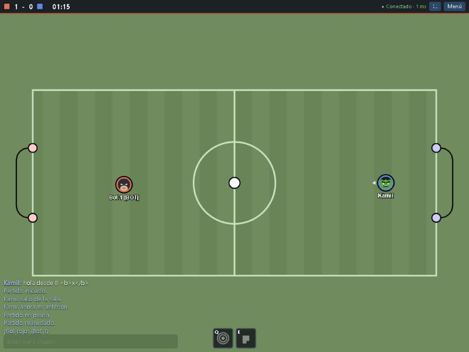
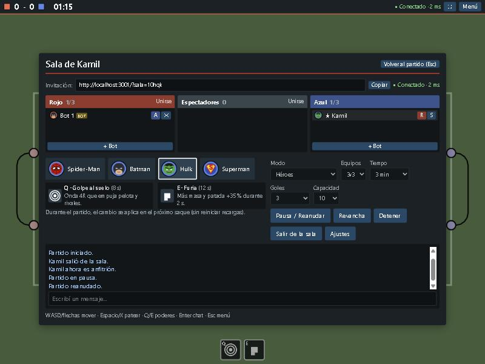
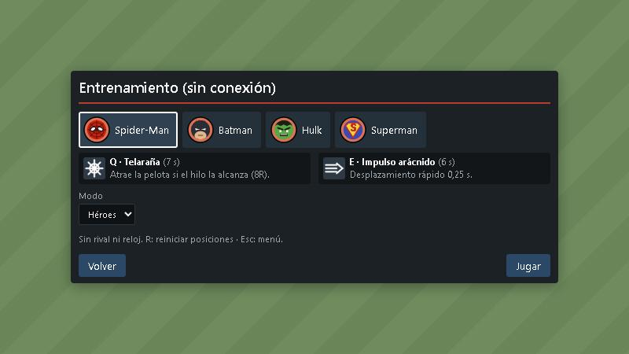
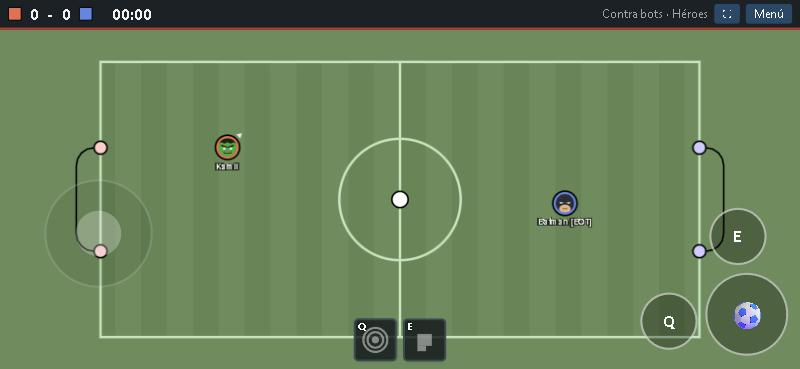

# HeroBall

Fútbol 2D multijugador en el navegador, con vista cenital, jugadores como discos y superpoderes.
Proyecto independiente **inspirado en HaxBall**; no es HaxBall ni su sitio oficial. Código y gráficos propios.



## Jugar en línea

**https://kamuluuuu-ai.github.io/heroball/**

La versión web no tiene servidor central: quien toca *Crear sala* aloja la partida en su navegador
(corre la simulación autoritativa, igual que el servidor Node) y los demás entran con el enlace de invitación,
conectados por WebRTC. La señalización usa el servicio público gratuito de [PeerJS](https://peerjs.com)
(peerjs.com), que también ofrece STUN/TURN. Limitaciones de este modo:

- No hay lista pública de salas: se entra por enlace o código.
- Si el anfitrión cierra o minimiza mucho tiempo la pestaña, la sala termina para todos.
- Algunas redes muy restrictivas pueden bloquear WebRTC; ahí no se podrá conectar.
- Entrenamiento y partidos contra bots funcionan sin conexión, igual que siempre.

El sitio se publica solo con GitHub Actions (`.github/workflows/pages.yml`) en cada push a `main`.

## Ejecutar

Requiere Node.js 20 o superior (probado con Node 24).

```bash
npm install
npm run dev        # servidor (3001) + cliente Vite (5173) con recarga en caliente
```

Abrí <http://localhost:5173>.

Producción (un solo proceso sirve la app compilada y el WebSocket):

```bash
npm run build      # comprobación de tipos + build del cliente en dist/
npm start          # http://localhost:3001  (WebSocket en /ws)
```

Otros comandos: `npm test` (Vitest), `npm run typecheck`, `npm run build:pages` (versión web sin servidor en `dist-pages/`; usa `VITE_BASE=/heroball/` para la ruta de GitHub Pages).

Variables: `PORT` (por defecto 3001) y `HOST` (por defecto `0.0.0.0`).

### Jugar desde otra máquina

1. En la máquina servidor: `npm install && npm run build && npm start`.
2. Desde otra PC/celular **de la misma red**: `http://IP-DEL-SERVIDOR:3001` (por ejemplo `http://192.168.0.10:3001`).
   Puede hacer falta permitir el puerto 3001 en el firewall.
3. Para jugar por Internet hace falta publicar el servidor (abrir el puerto en el router, un VPS o un túnel).
   Un enlace `localhost` sólo funciona en la misma computadora.

El enlace de invitación de cada sala es `http://HOST:PUERTO/?sala=ID` (botón *Copiar* en la sala).

## Controles

| Acción | Teclado | Táctil |
|---|---|---|
| Moverse (8 direcciones) | WASD o flechas | joystick (mitad izquierda) |
| Patear | Espacio o X | botón ⚽ |
| Poder 1 / Poder 2 | Q / E | botones Q / E |
| Chat | Enter | — |
| Menú / sala | Esc | botón Menú |
| Reiniciar posiciones (entrenamiento) | R | menú |

Mientras escribís en el chat o en un formulario, los controles del partido no se activan. Al perder el foco
(cambiar de ventana, ocultar la pestaña) se sueltan todas las teclas. Ajustes (sonido, volumen, escala de
cámara, nombres, controles táctiles) se guardan en el navegador (`localStorage`).

## Modos

- **Entrenamiento** (sin conexión): sólo vos y la pelota, sin reloj; R reinicia posiciones; cambio de héroe instantáneo.
- **Contra bots** (sin conexión): 1v1, 2v2 o 3v3 contra bots (marcados como *[BOT]*).
- **Multijugador**: salas en el servidor. Modos **Héroes**, **Súper** (poderes potenciados) y **Clásico** (sin poderes). Por defecto: Héroes, 3 minutos, 3 goles.

Los tres modos se eligen también en entrenamiento y contra bots.

Flujo: apodo → lista de salas o entrenamiento → sala → equipo y héroe → partido.

En la sala: equipos Rojo / Espectadores / Azul, chat, invitación. El anfitrión (★) inicia, pausa, pide revancha,
detiene, cambia límites, mueve jugadores, agrega bots y expulsa. Si el anfitrión se va, pasa al humano más antiguo.
Una sala sin humanos se elimina.

## Héroes y poderes

Todos comparten la física base; sólo cambian los poderes. R = radio de un jugador (15).

| Héroe | Q | E |
|---|---|---|
| Spider-Man | **Telaraña**: hilo con autoapuntado a la pelota (si está a 8R y a la vista; si no, hacia la dirección apuntada); si toca la pelota la atrae hasta 0,7 s (sigue siendo física: no se teletransporta ni se pega; se corta por distancia u obstáculo). CD 7 s | **Impulso arácnido**: 0,25 s a ~2× la velocidad normal, con colisiones. CD 6 s |
| Batman | **Batarang**: proyectil 9R con autoapuntado al objetivo (pelota o rival) más alineado con tu dirección, dentro de ±90°; empuja la pelota o frena 30 % la aceleración de un rival 0,8 s; atraviesa aliados; un impacto. CD 6 s | **Gancho**: se lanza solo hacia la pelota (anticipando su movimiento, 10R). Si la engancha, tira de Batman hacia ella hasta 0,9 s con física normal: choca con quien esté en el camino; se corta por obstáculo o al llegar. Una marca amarilla sobre la pelota indica que está a tu alcance. CD 7 s |
| Hulk | **Golpe al suelo**: onda 4R que empuja pelota y rivales con fuerza decreciente; no atraviesa paredes/postes. CD 8 s | **Furia**: 2 s con masa ×2,5 y patada +35 %, aceleración −15 %; el radio no cambia. CD 12 s |
| Superman | **Súper disparo**: la siguiente patada válida +50 % (vence a los 2 s). CD 8 s | **Súper velocidad**: 1,2 s con +40 % de aceleración y de límite de velocidad. CD 10 s |

### Modo Súper

Mismos héroes y controles, con cada poder potenciado y recargas más cortas:

| Héroe | Q | E |
|---|---|---|
| Spider-Man | **Súper telaraña**: alcance de toda la cancha; atrae la pelota más fuerte (hasta 1,4 s). Si el hilo toca a un rival, se le pega y lo arrastra hacia vos 0,7 s. El autoapuntado elige entre pelota y rivales según tu dirección. CD 5 s | **Impulso arácnido**: 0,4 s a ~2,6× la velocidad. CD 3,5 s |
| Batman | **Triple batarang**: tres batarangs en abanico (±14°), 13R, frenan 50 % durante 1,3 s y empujan más la pelota. CD 4,5 s | **Súper gancho**: alcance de toda la cancha, tirón más fuerte (1,6 s) y al llegar empuja la pelota en la dirección del viaje. CD 4 s |
| Hulk | **Terremoto**: onda 7R, empuje mucho mayor y aturde a los rivales alcanzados (−50 % aceleración 1 s). CD 5 s | **Furia total**: 4 s con masa ×4 y patada +70 %, sin perder aceleración. CD 8 s |
| Superman | **Disparo de acero**: próxima patada ×2,2 (vence a los 4 s). CD 5 s | **Vuelo supersónico**: 2,5 s con +80 % de aceleración y de límite de velocidad. CD 6 s |

Los valores están en `SUPER_POWERS` (`shared/config.ts`), con la misma forma que `POWERS`.

Reglas comunes: la dirección apuntada es la última dirección de movimiento (al aparecer, hacia el arco rival;
se ve como una flecha junto a tu jugador). El autoapuntado de Spider-Man y Batman anticipa el movimiento del objetivo, no atraviesa postes ni paredes y lo calcula el servidor; cuando tu Q está lista, una mira marca el objetivo. Se desactiva con `autoAim: false` en `shared/config.ts`. Los poderes se activan por flanco (mantener apretado no repite),
no funcionan en el saque, la pausa, la celebración ni como espectador. Las ralentizaciones no se suman: vale la
más fuerte. Al marcar un gol se limpian proyectiles y efectos, y en el siguiente saque todos tienen sus poderes.
Cambiar de héroe durante el partido se aplica en el próximo saque.

## Arquitectura

```
shared/      motor común cliente/servidor (TypeScript puro, sin DOM)
  config.ts    parámetros de física, estadio, reglas y poderes (todo editable)
  physics.ts   discos, segmentos, colisiones, subpasos
  game.ts      reglas: entradas, patada, saque y barreras, goles, tiempo, gol de oro
  powers.ts    poderes, proyectiles, hilos (telaraña y gancho), efectos
  bot.ts       IA de bots (sólo genera bits de entrada)
  protocol.ts  mensajes y validación
  types.ts     estado del juego y bits de entrada
server/      Node + ws: sirve dist/ y /ws; salas en memoria; bucle autoritativo a 60 Hz
  handler.ts   manejo de mensajes (compartido con el anfitrión en navegador)
client/src/
  game/        render Canvas 2D, entrada (teclado/táctil), red y transportes (WebSocket / WebRTC), sesiones, audio
  ui/          React: menús, sala, HUD (el HUD se escribe directo en el DOM, no por fotograma en React)
tests/       Vitest: física, poderes, servidor/salas, estabilidad con bots
```

### Red

- **Servidor autoritativo**: el cliente sólo envía `{seq, bits}` 60 veces por segundo. El servidor simula
  física, poderes, impactos y goles, y procesa una entrada por tick (si se acumulan, descarta las viejas sin
  perder pulsaciones de Q/E/patada; si dejan de llegar durante 0,5 s, suelta todo).
- **Snapshots** a 30 Hz con el estado completo y el número de la última entrada procesada (`ack`).
- **Predicción y reconciliación** del jugador local: al llegar un snapshot, el cliente parte de ese estado y
  vuelve a simular sólo las entradas no confirmadas. Las activaciones de poderes ya procesadas llegan dentro del
  estado (con su cooldown), así que reprocesar no las duplica. Las correcciones se suavizan visualmente.
- **Vista del jugador**: mientras jugás, la pelota y todos los jugadores se dibujan desde el mundo predicho (el
  mismo instante que tu jugador; los rivales se extrapolan con su última entrada) y cada corrección del servidor
  se reparte en unos fotogramas. Así lo que ves tocar es lo que choca y lo que está en rango de patada.
- **Interpolación** para espectadores, con ~100 ms de colchón; reloj de render separado del de simulación.
- Validación: tamaño máximo de mensaje (2 KB), forma y rangos de cada campo, límites de frecuencia por tipo
  (entradas, chat, acciones), permisos de anfitrión. El chat se muestra siempre como texto (nunca HTML).
- `?lag=200` en la URL agrega ~200 ms de latencia artificial ida y vuelta (sólo para pruebas).

Esta arquitectura cliente-servidor es una elección de HeroBall; HaxBall documenta conexiones WebRTC entre
jugadores y anfitrión.

## Parámetros de física

Todos en `shared/config.ts`. Unidades: px lógicos y ticks (60/s).

Valores que se leyeron en el cliente público de HaxBall al inspeccionarlo (física por defecto y estadio
*Classic*) y se usan como punto de partida: jugador radio 15, `bCoef` 0,5, `invMass` 0,5, amortiguación 0,96,
aceleración 0,1 (0,07 y 0,96 manteniendo patear), fuerza de patada 5; pelota radio 10, `bCoef` 0,5, `invMass` 1,
amortiguación 0,99; cancha 370×170 (semiejes), estadio 420×200, arco ±64, postes radio 8, círculo central 75,
alcance de patada 4. El motor es propio, así que la sensación puede no ser idéntica.

Decisiones de HeroBall (no son datos de HaxBall): intervalo mínimo entre patadas 6 ticks, mantener patear no
repite (configurable con `KICK.holdRepeatTicks`), profundidad del arco 30, topes de velocidad (jugador 7,
pelota 15), subpasos de como máximo 4 px por paso, pausa de gol 2,5 s, todos los valores de poderes y la IA.

## Pruebas

`npm test` ejecuta 64 pruebas: movimiento/frenado, diagonales, patada dentro/fuera de alcance y mantener
apretado, conservación de momento, tiros a velocidad máxima contra pared/poste/red, gol contado una vez, saque y
barreras, victoria por goles y por tiempo, gol de oro, cada poder y su cooldown, el gancho (llega a la pelota, atraviesa jugadores, falla fuera de alcance, se corta tras un poste), cada poder del modo Súper (telaraña de cancha completa, arrastre de rivales, triple batarang, súper gancho, terremoto, disparo de acero), limpieza de efectos, cambio de
héroe, validación de mensajes, permisos, transferencia de anfitrión, aislamiento entre salas, confirmación de
secuencias sin duplicar poderes, un partido 3v3 completo con bots en Héroes y en Súper sin valores inválidos, autoapuntado (pelota quieta, en movimiento, fuera de cono, detrás de poste) y una prueba cliente-servidor con ~200 ms de latencia que verifica que jugador y pelota nunca se dibujan encimados.

## Capturas

| Sala | Héroes | Móvil horizontal |
|---|---|---|
|  |  |  |

## Limitaciones conocidas

- Salas en memoria: se pierden al reiniciar el servidor. No hay cuentas, contraseñas de sala ni baneos persistentes.
- Snapshots completos en JSON: suficiente para pocas salas en red local; para muchas salas convendría un formato
  binario y deltas.
- Un solo estadio (equivalente al *Classic*). No se cargan archivos `.hbs`.
- La IA de los bots es simple.

## Licencia

MIT. Ver [LICENSE](LICENSE). HeroBall es un proyecto independiente; HaxBall es una marca de sus respectivos dueños.
