# HeroBall

Fútbol 2D multijugador en el navegador, con vista cenital, jugadores como discos y superpoderes.
Proyecto independiente **inspirado en HaxBall**; no es HaxBall ni su sitio oficial. Código y gráficos propios.

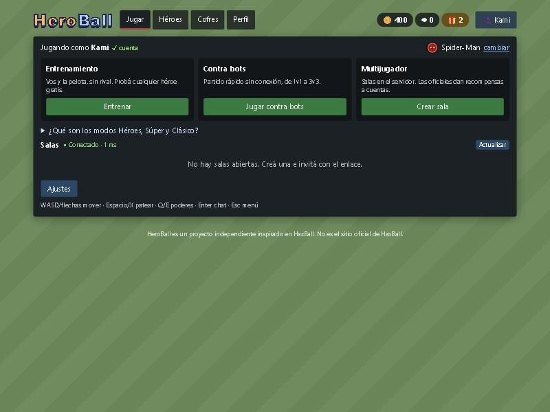

> **Estado de la economía.** Cuentas, monedas, cofres, colección, partidas oficiales y administración están
> terminados y probados **contra PostgreSQL real en local**. El sitio público de GitHub Pages **todavía no tiene
> backend desplegado**: ahí se juega como invitado (entrenamiento, bots y salas P2P casuales) y las pestañas
> Cofres/Perfil explican que no hay servidor de cuentas. Ver [Pendientes reales](#pendientes-reales).

## Jugar en línea

**https://kamuluuuu-ai.github.io/heroball/**

La versión web no tiene servidor central: quien toca *Crear sala* aloja la partida en su navegador
(corre la simulación autoritativa, igual que el servidor Node) y los demás entran con el enlace de invitación,
conectados por WebRTC ([PeerJS](https://peerjs.com) para la señalización). Estas salas son **siempre casuales**:
un navegador anfitrión no puede emitir recompensas. Limitaciones de este modo:

- No hay lista pública de salas: se entra por enlace o código.
- Si el anfitrión cierra o minimiza mucho tiempo la pestaña, la sala termina para todos.
- Algunas redes muy restrictivas pueden bloquear WebRTC.
- Entrenamiento y partidos contra bots funcionan sin conexión.

El sitio se publica con GitHub Actions (`.github/workflows/pages.yml`) en cada push a `main`.

## Ejecutar en local (con cuentas y economía)

Requiere Node.js 20 o superior (probado con Node 24). No hace falta Docker.

```bash
npm install
cp .env.example .env          # completar BETTER_AUTH_SECRET (32+ caracteres aleatorios)
npm run dev:db                # PostgreSQL embebido en .data/dev (puerto 54329); dejarlo abierto
npm run dev                   # otra terminal: servidor (3001) + Vite (5173)
```

Abrí <http://localhost:5173>, creá una cuenta en *Perfil* y vas a recibir la bienvenida (400 HeroCoins y
2 cofres estándar). Con Docker, en lugar de `npm run dev:db`: `docker compose up -d`.

- Migraciones: se aplican al arrancar (`MIGRATE_ON_START=1`) o con `npm run db:migrate`. Están en `migrations/`.
- Sin `DATABASE_URL` el servidor arranca igual, sólo con partidas casuales (`/api/*` responde 503 `no_economy`).
- Sin `SMTP_URL`, el enlace de recuperación de contraseña se escribe en la consola del servidor.
- Producción en un solo proceso: `npm run build && npm start` (sirve `dist/`, la API y el WebSocket en `/ws`).

### Administrador inicial

No hay usuario ni contraseña de administrador por defecto. El rol se asigna **desde el servidor**, nunca desde el
navegador:

```bash
# 1) la persona crea su cuenta normalmente desde el juego; 2) en el servidor:
npm run admin:role -- --email persona@ejemplo.com --role economy_admin
npm run admin:role -- --email persona@ejemplo.com --role moderator
npm run admin:role -- --email persona@ejemplo.com --role moderator --remove
```

- `economy_admin`: pestaña **Administración** (buscar usuarios, ver saldos e historial, entregar o corregir).
- `moderator`: permisos de anfitrión en cualquier sala (expulsar, pausar, configurar, mover) y panel de estado.

## Desplegar

### Backend (Node + PostgreSQL)

Sirve cualquier hosting de Node con HTTPS (VPS, Render, Railway, Fly.io…) y un PostgreSQL gestionado (Neon,
Supabase, Railway…). Pasos:

1. Variables de entorno (ver `.env.example`): `DATABASE_URL`, `BETTER_AUTH_SECRET`, `PUBLIC_API_URL`
   (la URL HTTPS del backend), `CORS_ORIGINS=https://kamuluuuu-ai.github.io`, `SMTP_URL` y `MAIL_FROM`
   (recuperación de contraseña), opcionalmente `MODERATOR_SIGNING_KEY` y `ADMIN_MAX_COINS`/`ADMIN_MAX_CHESTS`.
2. `npm ci && npm run db:migrate && npm start` (o `MIGRATE_ON_START=1`).
3. Comprobar `GET https://tu-backend/api/health` → `{"ok":true,"economy":true}`.
4. Asignar el administrador inicial con `npm run admin:role` (arriba).

`MODERATOR_SIGNING_KEY` es la clave **privada** (PKCS#8 base64) que corresponde a la clave pública de
`shared/admin.ts`. Sólo vive en el servidor: con ella el backend firma el desafío de una sala P2P para una cuenta
con rol `moderator`. Si ya tenías la clave del administrador anterior, va acá; para generar otra:
`npm run admin:keygen` y publicar la pública nueva en `shared/admin.ts`.

### Frontend (GitHub Pages)

En el repositorio: *Settings → Secrets and variables → Actions → Variables*, crear `VITE_API_URL` con la URL
del backend (sin barra final) y hacer push a `main`. El workflow la pasa al build. Sin esa variable, el sitio
queda en modo invitado. El WebSocket de salas del servidor se deriva de la misma URL (`wss://…/ws`).

## Cuentas, economía y partidas oficiales

Toda la economía se decide en el servidor. El navegador sólo guarda el token de sesión y, si una operación quedó
sin respuesta, su clave de idempotencia; nunca saldos, héroes ni roles.

- **Cuentas** (Better Auth, correo y contraseña de 8+ caracteres): id estable, recuperación por correo con
  enlace que vence en 30 min y cierra las demás sesiones. El frontend de Pages vive en otro origen, así que la
  sesión viaja como token `Bearer`, no como cookie. Se puede seguir jugando como invitado.
- **Monedas**: HeroCoins (se ganan y gastan) y Fragmentos (salen de héroes repetidos y desbloquean héroes).
- **Cofres** (configuración versionada en `shared/economy.ts`):

  | Cofre | Precio | Común | Raro | Épico | Legendario |
  |---|---|---|---|---|---|
  | Estándar | 200 | 60 % | 28 % | 10 % | 2 % |
  | Élite | 600 | — | 70 % | 25 % | 5 % |

  Garantías: épico o mejor a más tardar en la apertura 10 sin épico; legendario a más tardar en la 30; si
  coinciden, gana la legendaria. Dentro de cada rareza, cada héroe tiene la misma probabilidad. Repetidos:
  10/25/60/150 Fragmentos; desbloqueo directo: 100/250/600/1500. El sorteo usa `crypto.randomInt` en el servidor.
- **Partidas oficiales** (sólo en el servidor, nunca P2P): 40 HeroCoins por completarla + 20 por ganar, tope 400
  por día; requisitos: al menos 60 s, modo Héroes o Clásico, cuentas distintas en ambos equipos, al menos 2
  patadas por equipo, 60 % de participación (8 s sin cambiar de entrada cuenta como AFK), seguir en el equipo al
  final y no repetir los mismos rivales más de 3 veces en el día. Detener o reiniciar antes del final no da nada.
  Objetivos: 3 oficiales al día → +80; 15 a la semana → +1 cofre élite. Días y semanas en hora de Montevideo
  (la semana empieza el lunes).
- **Garantías técnicas**: cada operación lleva una clave de idempotencia (doble clic o reintento no cobran dos
  veces); la billetera se bloquea por usuario (`SELECT … FOR UPDATE`); el libro de movimientos y las aperturas son
  sólo de agregado (un disparador impide modificarlos); las correcciones son movimientos compensatorios.
- **Errores de red**: si se envió una compra o apertura y no llegó la respuesta, aparece un aviso con
  *Comprobar*, que reenvía la misma operación con la misma clave: si ya se hizo, el servidor devuelve el resultado
  original. Una apertura que no llegaste a ver (pestaña cerrada) se muestra al volver.

Simulación de progreso (`npm run economy:simulate`): con un jugador casual se completan los 8 héroes no iniciales en
una mediana de 42 días; regular, 27; intenso, 21. Tasa efectiva de legendario ≈ 4,7 %.

## Interfaz

Pestañas **Jugar** (entrenamiento, bots y multijugador separados; lista de salas compacta con tipo Oficial/Casual),
**Héroes** (colección de 12 con filtros por rareza, rol y disponibilidad; descripción de Q/E con recargas; cómo se
consigue; equipar; probar gratis en entrenamiento), **Cofres** (saldo, compra, apertura, probabilidades base y para
tu próxima apertura, progreso de garantías), **Perfil** (cuenta, estadísticas verificadas, objetivos con hora de
reinicio, historial de movimientos y aperturas) y **Administración** (sólo con rol).

La apertura de cofres sólo empieza cuando el servidor confirmó el resultado; la animación dura 1,5 s, es neutra
(no insinúa otra rareza), se puede saltar y se omite con *reducir movimiento*. Muestra héroe, rareza (color, icono
y texto), si es nuevo o repetido y los Fragmentos, con *Equipar*, *Ver colección* y *Cerrar*.

| Cofres | Apertura | Apertura recuperada |
|---|---|---|
| 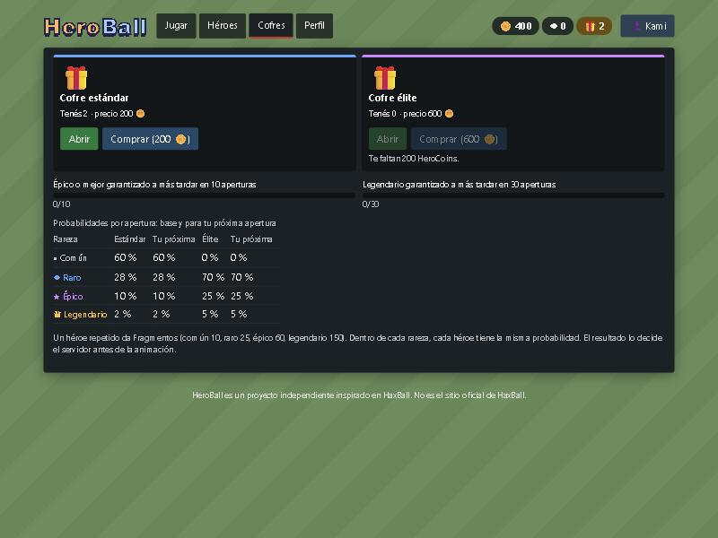 | 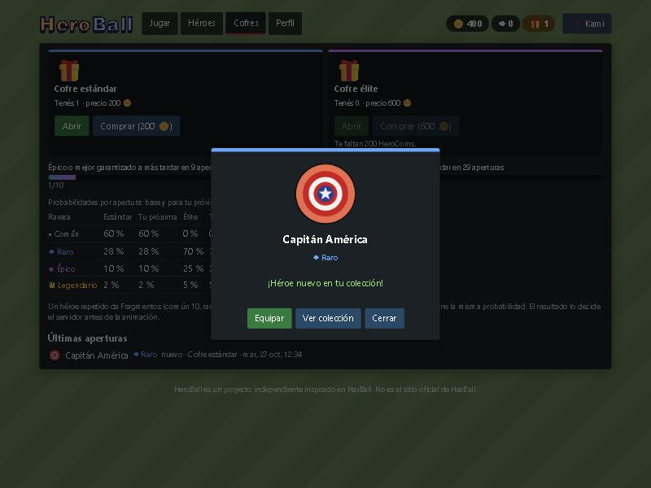 | 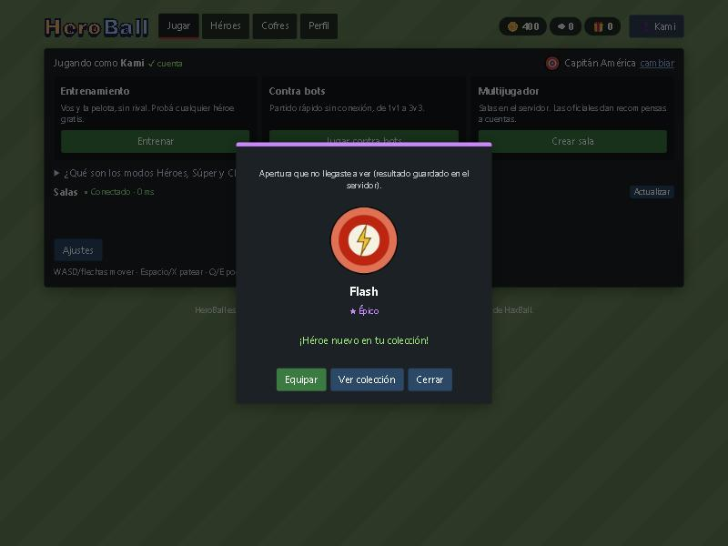 |

| Colección | Perfil | Sala oficial |
|---|---|---|
| 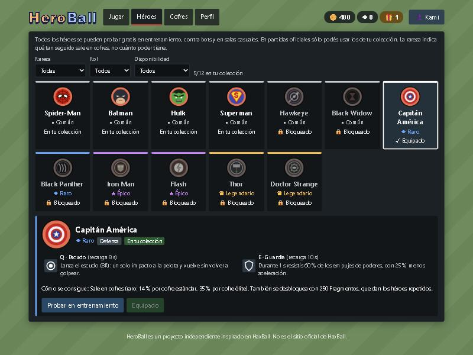 | 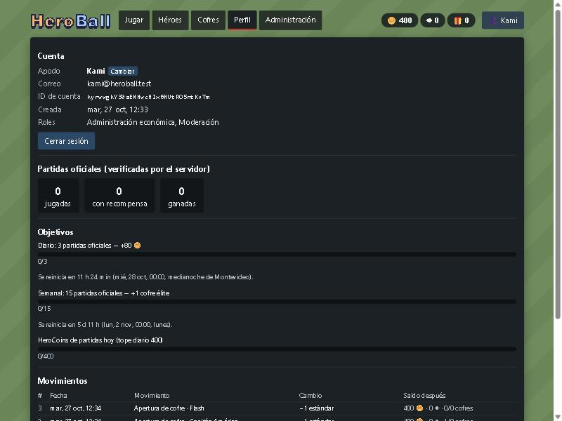 | 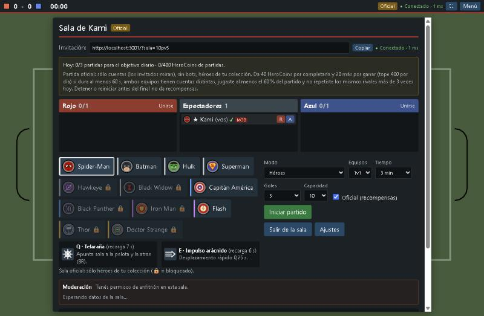 |

| Administración: vista previa | Entrega registrada | Avisos del destinatario |
|---|---|---|
| 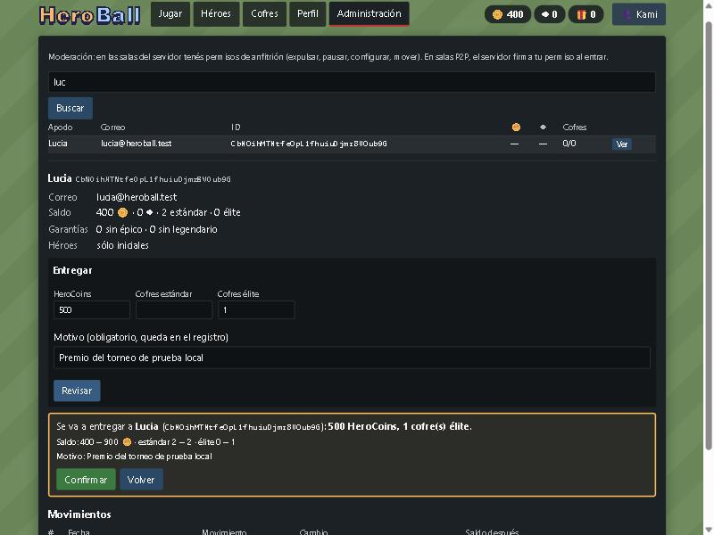 | 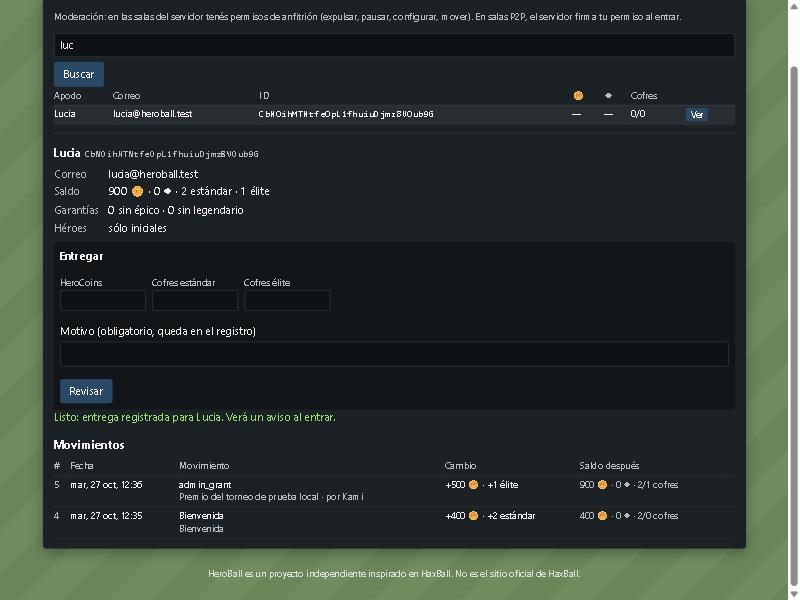 | 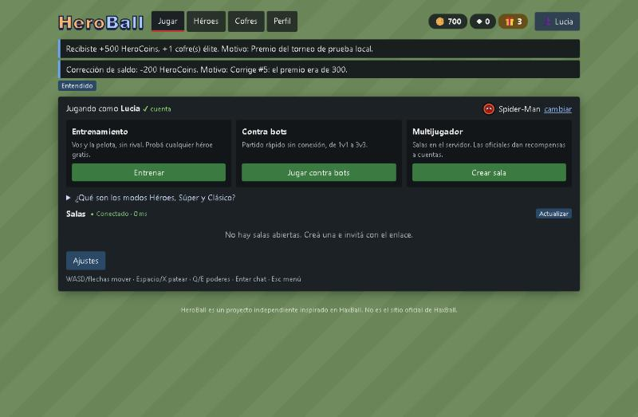 |

| HUD con nombre y estado de Q/E | Móvil vertical | Crear sala oficial |
|---|---|---|
| 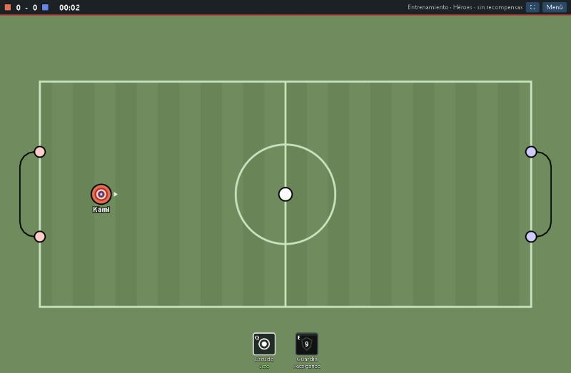 | 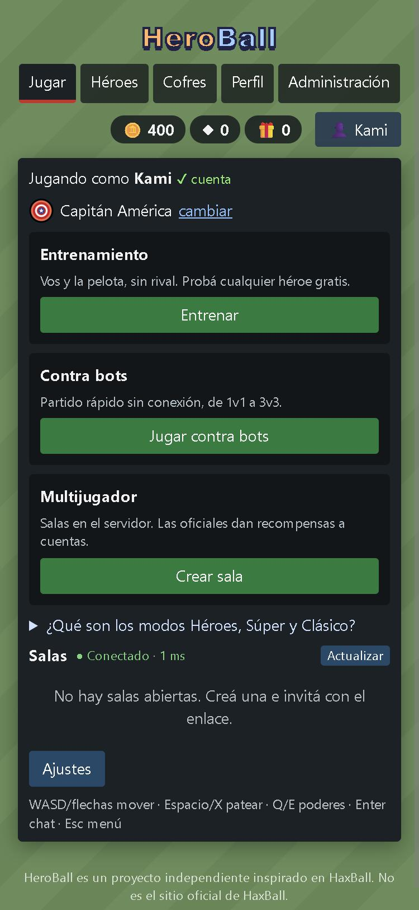 | 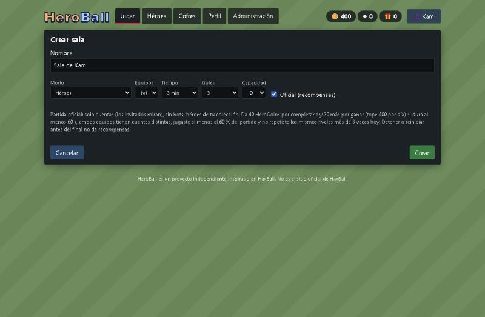 |

Capturas reales tomadas del servidor local con PostgreSQL embebido y cuentas de prueba.

## Administración

- Buscar por id estable, apodo o correo; ver HeroCoins, Fragmentos, cofres, garantías, héroes, movimientos y
  aperturas.
- Entregar HeroCoins y cofres estándar/élite con **motivo obligatorio** (5 a 200 caracteres), dentro de los límites
  por operación. *Revisar* muestra destinatario, id, cantidades y saldo antes/después; *Confirmar* usa una clave
  fijada al revisar (un doble clic no entrega dos veces). Nadie puede entregarse recursos a sí mismo.
- Correcciones: sólo como movimiento compensatorio que referencia al original (*Corregir* en una entrega). Nada se
  edita ni se borra.
- El destinatario ve un aviso la próxima vez que entra, aunque estuviera desconectado.
- Moderación en salas: con rol `moderator`, en el servidor el rol llega con la sesión verificada; en salas P2P el
  backend firma el desafío de la conexión (la clave privada nunca llega al navegador). La marca **MOD** identifica
  al moderador verificado y **✔** a las cuentas verificadas.

## Controles

| Acción | Teclado | Táctil |
|---|---|---|
| Moverse (8 direcciones) | WASD o flechas | joystick (mitad izquierda) |
| Patear | Espacio o X | botón ⚽ |
| Poder 1 / Poder 2 | Q / E | botones Q / E |
| Chat | Enter | — |
| Menú / sala | Esc | botón Menú |
| Volver al centro (entrenamiento) | R | menú |

Debajo de cada poder el HUD muestra su nombre y su estado en texto: *Listo*, *Activo*, *Recargando* (con segundos)
o *En pausa*.

## Modos

- **Héroes**: dos poderes (Q y E) con recarga. Puede ser oficial.
- **Súper**: mismos héroes con poderes potenciados (`SUPER_POWERS` en `shared/config.ts`). Sólo casual.
- **Clásico**: sin poderes. Puede ser oficial.

Entrenamiento (sin rival ni límite) y partidos contra bots (1v1 a 3v3, bots con cualquiera de los 12 héroes)
funcionan sin conexión y no dan recompensas. Todos los héroes se pueden usar en entrenamiento, bots y salas casuales;
en salas oficiales el servidor sólo acepta los de tu colección.

## Héroes y poderes

Todos comparten la física base; sólo cambian los poderes. R = radio de un jugador (15). La rareza indica la
frecuencia en cofres, no el poder. Tabla generada desde `shared/config.ts` con `npx tsx scripts/hero-table.ts`:

| Héroe | Rareza · rol | Q | E |
|---|---|---|---|
| Spider-Man | Común (inicial) · Control | **Telaraña**: Apunta sola a la pelota y la atrae (8R). CD 7 s | **Impulso arácnido**: Desplazamiento rápido 0,25 s. CD 6 s |
| Batman | Común (inicial) · Control | **Batarang**: Apunta solo al objetivo más alineado: empuja la pelota o frena a un rival (9R). CD 6 s | **Gancho**: Se engancha a la pelota y te lleva hacia ella (10R). CD 7 s |
| Hulk | Común (inicial) · Defensa | **Golpe al suelo**: Onda 4R que empuja pelota y rivales. CD 8 s | **Furia**: Más masa y patada +35 % durante 2 s. CD 12 s |
| Superman | Común (inicial) · Ataque | **Súper disparo**: Próxima patada +50 % (2 s). CD 8 s | **Súper velocidad**: +40 % aceleración y velocidad 1,2 s. CD 10 s |
| Hawkeye | Común · Ataque | **Flecha de precisión**: Flecha recta (10R) que empuja la pelota. Sin seguimiento; la frena cualquier jugador. CD 7 s | **Paso lateral**: Desplazamiento de hasta 2,5R hacia donde apuntás, chocando normalmente. CD 8 s |
| Black Widow | Común · Control | **Descarga**: Proyectil (6R): el primer rival alcanzado acelera 20 % menos durante 0,7 s. CD 8 s | **Evasión**: Durante 0,6 s recibís 50 % menos de empuje de poderes. Seguís chocando. CD 10 s |
| Capitán América | Raro · Defensa | **Escudo**: Lanza el escudo (8R): un solo impacto a la pelota y vuelve sin volver a golpear. CD 8 s | **Guardia**: Durante 1 s resistís 60 % de los empujes de poderes, con 25 % menos aceleración. CD 10 s |
| Black Panther | Raro · Movilidad | **Salto felino**: Avance de hasta 4R hacia donde apuntás; se detiene ante jugadores, pelota u obstáculos. CD 8 s | **Pulso cinético**: Tras 0,3 s de aviso empuja a los rivales a 3R y un poco la pelota. CD 10 s |
| Iron Man | Épico · Ataque | **Repulsor**: Disparo recto (10R) que impulsa la pelota en la dirección del disparo. Sin autoapuntado. CD 8 s | **Propulsores**: +30 % aceleración y velocidad máxima durante 0,9 s, girando peor. CD 10 s |
| Flash | Épico · Movilidad | **Carrera relámpago**: +50 % aceleración y +35 % velocidad máxima durante 0,7 s. CD 8 s | **Estela**: Deja una estela (1,2 s) que reduce 15 % la aceleración rival; dura hasta 0,5 s tras salir. CD 11 s |
| Thor | Legendario · Defensa | **Mjolnir**: Martillo (8R) que empuja la pelota o al primer rival alcanzado. CD 9 s | **Trueno**: Marca una zona de 3R delante durante 0,5 s; luego empuja todo lo que siga dentro. CD 12 s |
| Doctor Strange | Legendario · Control | **Desvío arcano**: Portal hasta 6R delante: durante 1 s desvía la pelota una vez hasta 30° hacia la flecha, sin acelerarla. CD 10 s | **Paso místico**: Teletransporte de hasta 3R con recorrido libre; no atraviesa paredes, jugadores ni pelota. CD 12 s |

Balance medido con bots (`tests/balance.test.ts`, 1v1 contra cada inicial): todos los nuevos quedan entre 35 % y
50 % de los goles. Reglas comunes: los poderes se activan por flanco, no funcionan en saque, pausa, celebración ni
como espectador; las ralentizaciones y resistencias no se suman (vale la más fuerte); al marcar se limpian
proyectiles, zonas y efectos.

## Arquitectura

```
shared/      motor común cliente/servidor (TypeScript puro, sin DOM)
  config.ts    física, estadio, reglas, poderes, catálogo de héroes (rareza y rol)
  economy.ts   precios, probabilidades, garantías, recompensas y calendario (versionado)
  game.ts / physics.ts / powers.ts / bot.ts / protocol.ts / types.ts
server/
  index.ts     HTTP + WebSocket; sin DATABASE_URL, sólo casual
  auth.ts      Better Auth (correo y contraseña, token Bearer)
  api.ts       /api/me, cofres, héroes, moderación y administración (CORS con lista blanca)
  economy.ts   operaciones con transacciones, bloqueo por billetera e idempotencia
  official.ts  reglas puras de elegibilidad de partidas oficiales
  room.ts / handler.ts  salas autoritativas (también corren en el navegador anfitrión P2P)
migrations/  SQL (auth y economía)
client/src/
  account.ts   cliente de la API (sesión, claves de idempotencia, operación pendiente)
  game/        render Canvas 2D, entrada, red y transportes (WebSocket / WebRTC), sesiones, audio
  ui/          React: pestañas (Meta.tsx), sala y partido (App.tsx), HUD (GameView.tsx)
scripts/     base embebida, migraciones, roles, simulación de economía, tabla de héroes
tests/       Vitest
```

### Red

- **Servidor autoritativo**: el cliente envía `{seq, bits}` 60 veces por segundo; el servidor simula física,
  poderes y goles. Snapshots a 30 Hz con el último `ack`.
- **Predicción y reconciliación** del jugador local; interpolación para espectadores.
- Validación de tamaño, forma y rangos de cada mensaje, límites de frecuencia y permisos.
- El token de sesión sólo se envía al servidor propio, nunca a un anfitrión P2P.
- `?lag=200` agrega ~200 ms de latencia artificial (sólo pruebas).

## Parámetros de física

Todos en `shared/config.ts` (px lógicos y ticks de 60/s). Los valores base (jugador radio 15, pelota radio 10,
amortiguación 0,96/0,99, patada 5, cancha 370×170…) se tomaron del cliente público de HaxBall como punto de
partida; el motor es propio y la sensación puede no ser idéntica. El modo *Depuración de contacto* (Ajustes)
dibuja radios, alcance de patada y posiciones de red.

## Cambios (ordenados por importancia)

1. **Contacto con la pelota**: corrección medida de la hitbox y del alcance de patada, con capa de depuración.
2. **Cuentas recuperables** (Better Auth) con persistencia en PostgreSQL; el invitado sigue pudiendo jugar.
3. **Economía en el servidor**: HeroCoins, Fragmentos, cofres con probabilidades publicadas y garantías,
   duplicados, desbloqueo; idempotencia, bloqueo por billetera y registro sólo de agregado.
4. **Partidas oficiales autoritativas** con recompensas, tope diario, objetivos diario/semanal y reglas anti-abuso;
   el anfitrión P2P no puede emitir recompensas.
5. **Administración y moderación por roles** asignados desde el servidor: entregas con vista previa y motivo,
   correcciones compensatorias, avisos al destinatario. Se eliminó la clave privada guardada en el navegador.
6. **Ocho héroes nuevos** (Hawkeye, Black Widow, Capitán América, Black Panther, Iron Man, Flash, Thor, Doctor
   Strange) con versión Súper, bots y balance medido.
7. **Interfaz con pestañas**: colección, cofres con apertura recuperable, perfil con objetivos e historial.
8. **Pulido**: HUD con nombre y estado de cada poder en texto, mayor contraste y texto secundario más grande,
   nombres accesibles en botones de icono, indicador de partida oficial/casual, cuentas verificadas (✔), texto de
   entrenamiento corregido, diseño móvil vertical, bots con los 12 héroes.

## Pruebas

```bash
npm test          # 156 pruebas (incluye PostgreSQL embebido real en tests/db.test.ts)
npm run typecheck
```

Última ejecución: 12 archivos, 156 pruebas, todas pasan. Cubren física y poderes (incluidos los 8 héroes nuevos y
su balance), protocolo y salas, y contra PostgreSQL real: registro y bienvenida única, recuperación de cuenta en otro
navegador y restablecimiento de contraseña, persistencia tras reiniciar, compras y aperturas concurrentes y con
doble clic, fallo de red después de abrir, saldo insuficiente y sin cofres, ambas garantías y su prioridad,
duplicados y desbloqueo por Fragmentos, objetivos y tope diario, rivales repetidos, resultados P2P falsificados
rechazados, entregas administrativas (vista previa, idempotencia, auditoría, aviso offline, límites, autoentrega),
registro inmodificable, héroes bloqueados rechazados en salas oficiales, invitados sólo espectadores, partido
oficial completo con aviso por WebSocket y sin recompensa al detener o reiniciar. En el cliente: operación sin
respuesta que se confirma con la misma clave.

## Pendientes reales

- **Backend no desplegado públicamente.** El código, las migraciones y la configuración están listos, pero no hay
  servidor ni base de datos en Internet, así que en https://kamuluuuu-ai.github.io/heroball/ la economía **no está
  disponible**. Falta elegir hosting (Node + PostgreSQL con HTTPS), cargar las variables y crear `VITE_API_URL`.
- **Correo**: sin `SMTP_URL` real la recuperación de contraseña sólo funciona leyendo el enlace en la consola del
  servidor. No se probó con un proveedor SMTP real.
- **Moderación en el sitio público**: el acceso con la clave privada en el navegador se quitó a propósito. Hasta que
  haya backend con `MODERATOR_SIGNING_KEY`, no hay moderador global en las salas P2P de Pages.
- No verificado en el navegador: el aviso de recompensa al terminar una partida oficial entre dos personas reales
  (sí está cubierto por una prueba automatizada que juega el partido por WebSocket); controles táctiles en un
  teléfono físico (sólo emulación de tamaño).
- El límite de intentos de inicio de sesión es en memoria (un solo proceso). Con varias instancias haría falta un
  almacenamiento compartido.
- Salas en memoria: se pierden al reiniciar el servidor (las cuentas y la economía no).

## Licencia

MIT. Ver [LICENSE](LICENSE). HeroBall es un proyecto independiente; HaxBall es una marca de sus respectivos dueños.
